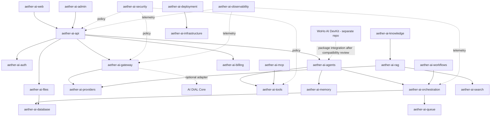

# Aether AI — Master Repository Catalog

**Research/design snapshot:** 2026-10-22. **Scope:** 33 Aether AI repositories; the existing `woho-ai-devkit` is a separate upstream dependency and is not included in this count.

## Current status

- Aether AI repositories in this plan: **33**.
- Repositories currently created: **10** (`aether-ai-platform` through `aether-ai-mcp`).
- Repositories still planned: **23**.
- Existing external dependency: [Monupatel62/woho-ai-devkit](https://github.com/Monupatel62/woho-ai-devkit), currently separate.
- Current work: **documentation only**. No Aether application code, service deployment, or production configuration is included in this documentation phase.

## Repository list

| # | Repository | Status | Responsibility |
|---:|---|---|---|
| 1 | [`aether-ai-platform`](https://github.com/Monupatel62/aether-ai-platform) | Created; documentation phase | Canonical architecture, repository map, ADRs, and roadmap |
| 2 | [`aether-ai-web`](https://github.com/Monupatel62/aether-ai-web) | Created; documentation phase | User-facing chat, workspace, agent-run, file, and settings UI |
| 3 | [`aether-ai-api`](https://github.com/Monupatel62/aether-ai-api) | Created; documentation phase | Authenticated product API/BFF and domain coordination |
| 4 | [`aether-ai-gateway`](https://github.com/Monupatel62/aether-ai-gateway) | Created; documentation phase | Unified model access, routing, streaming, timeout/retry policy |
| 5 | [`aether-ai-providers`](https://github.com/Monupatel62/aether-ai-providers) | Created; documentation phase | Provider-specific model adapters and capability metadata |
| 6 | [`aether-ai-agents`](https://github.com/Monupatel62/aether-ai-agents) | Created; documentation phase | Agent lifecycle, bounded execution, tool selection, approvals |
| 7 | [`aether-ai-workflows`](https://github.com/Monupatel62/aether-ai-workflows) | Created; documentation phase | Declarative workflow schema, validation, versioning |
| 8 | [`aether-ai-orchestration`](https://github.com/Monupatel62/aether-ai-orchestration) | Created; documentation phase | Durable run state, step transitions, retries, cancellation |
| 9 | [`aether-ai-tools`](https://github.com/Monupatel62/aether-ai-tools) | Created; documentation phase | Typed, permissioned first-party agent tools |
| 10 | [`aether-ai-mcp`](https://github.com/Monupatel62/aether-ai-mcp) | Created; documentation phase | MCP client/server protocol adapters and safe invocation |
| 11 | [`aether-ai-memory`](https://github.com/Monupatel62/aether-ai-memory) | Planned; not created yet | Conversation/session memory, retention, retrieval and summarization |
| 12 | [`aether-ai-rag`](https://github.com/Monupatel62/aether-ai-rag) | Planned; not created yet | Document ingestion hooks, chunking, embeddings, retrieval, citations |
| 13 | [`aether-ai-files`](https://github.com/Monupatel62/aether-ai-files) | Planned; not created yet | Secure file validation, metadata, storage, download authorization |
| 14 | [`aether-ai-knowledge`](https://github.com/Monupatel62/aether-ai-knowledge) | Planned; not created yet | Knowledge collections, source ownership, permissions, indexing status |
| 15 | [`aether-ai-auth`](https://github.com/Monupatel62/aether-ai-auth) | Planned; not created yet | Identity provider integration, sessions, role and authorization primitives |
| 16 | [`aether-ai-security`](https://github.com/Monupatel62/aether-ai-security) | Planned; not created yet | Shared security policies, redaction, guardrails, secret-handling rules |
| 17 | [`aether-ai-admin`](https://github.com/Monupatel62/aether-ai-admin) | Planned; not created yet | Privileged operator dashboard for models, users, policies, quotas |
| 18 | [`aether-ai-billing`](https://github.com/Monupatel62/aether-ai-billing) | Planned; not created yet | Plans, entitlements, usage metering, quotas and billing records |
| 19 | [`aether-ai-sdk`](https://github.com/Monupatel62/aether-ai-sdk) | Planned; not created yet | Typed public client SDK and shared API schemas |
| 20 | [`aether-ai-evaluations`](https://github.com/Monupatel62/aether-ai-evaluations) | Planned; not created yet | Repeatable model/agent eval datasets, runners, scoring, regressions |
| 21 | [`aether-ai-observability`](https://github.com/Monupatel62/aether-ai-observability) | Planned; not created yet | Structured logs, metrics, traces, run correlation and alerts |
| 22 | [`aether-ai-deployment`](https://github.com/Monupatel62/aether-ai-deployment) | Planned; not created yet | Container packaging, environment manifests, releases and rollback docs |
| 23 | [`aether-ai-docs`](https://github.com/Monupatel62/aether-ai-docs) | Planned; not created yet | Published guides, API manuals, tutorials, operations and release notes |
| 24 | [`aether-ai-database`](https://github.com/Monupatel62/aether-ai-database) | Planned; not created yet | Schemas, migrations, persistence helpers, retention and backup contracts |
| 25 | [`aether-ai-queue`](https://github.com/Monupatel62/aether-ai-queue) | Planned; not created yet | Queue abstraction, envelopes, retry/dead-letter and delivery semantics |
| 26 | [`aether-ai-cache`](https://github.com/Monupatel62/aether-ai-cache) | Planned; not created yet | Cache interfaces, key conventions, TTL/invalidation, tenant-aware helpers |
| 27 | [`aether-ai-search`](https://github.com/Monupatel62/aether-ai-search) | Planned; not created yet | Lexical/vector search, indexing, filters, ranking and access-aware queries |
| 28 | [`aether-ai-plugins`](https://github.com/Monupatel62/aether-ai-plugins) | Planned; not created yet | Plugin manifests, discovery, versions, lifecycle and compatibility |
| 29 | [`aether-ai-integrations`](https://github.com/Monupatel62/aether-ai-integrations) | Planned; not created yet | First-party connectors to external systems and credential handoff |
| 30 | [`aether-ai-testing`](https://github.com/Monupatel62/aether-ai-testing) | Planned; not created yet | Shared fixtures, contract/integration/smoke tests and quality gates |
| 31 | [`aether-ai-ui-components`](https://github.com/Monupatel62/aether-ai-ui-components) | Planned; not created yet | Accessible reusable UI components, theme tokens, interactions |
| 32 | [`aether-ai-enterprise`](https://github.com/Monupatel62/aether-ai-enterprise) | Planned; not created yet | Tenant controls, SSO policy, audit export, organization features |
| 33 | [`aether-ai-infrastructure`](https://github.com/Monupatel62/aether-ai-infrastructure) | Planned; not created yet | Infrastructure-as-code, environment provisioning, networking, managed services |

## End-to-end architecture (proposed)

This is a proposed logical graph, not a claim that all 33 repositories must become separate deployed services. Repository boundaries are for ownership; deployable boundaries are a later architecture decision.

## Core design rules

1. **One owner per responsibility.** Gateway owns model access; providers own protocol adapters; agents own agent runtime; workflows own workflow definitions; orchestration owns durable run state.
2. **No circular dependencies.** A lower-level shared library must not import a higher-level application.
3. **Use explicit contracts.** HTTP/OpenAPI, typed package interfaces, or versioned event envelopes; no direct access to another component's private internals or tables.
4. **Security by boundary.** Authenticate users, authorize each resource/tool action, isolate tenants, scope secrets, limit requests, and redact logs.
5. **Idempotent execution.** Retried jobs and tool actions must declare side-effect behavior and use idempotency keys or equivalent safeguards.
6. **Documentation before implementation.** Public interfaces, state machines, failure behavior, test plans, and dependency licenses must be reviewed before coding.
7. **No premature microservices.** A repository does not automatically equal a separately deployed service. Start with the smallest testable modules and split runtime services only for a concrete reason.
8. **Keep WoHoTech separate.** Aether AI has its own brand, repos, and product decisions.

## Documentation index

- [Master architecture](MASTER_ARCHITECTURE.md)
- [Project-wide implementation roadmap](IMPLEMENTATION_ROADMAP.md)
- [Decision log](DECISION_LOG.md)
- [Continuity guide for new chats](CONTINUITY_GUIDE.md)
- [Research and license matrix](RESEARCH_AND_LICENSES.md)
- [Individual repository specifications](repositories/)

## Status vocabulary

- **Created; documentation phase:** GitHub repository exists but implementation is not started.
- **Planned; not created yet:** name and responsibility are part of the architecture; repository still needs to be created.
- **Implemented:** must only be used after code and tests are present and verified.
- **Production:** must only be used after explicit release and operational verification.
